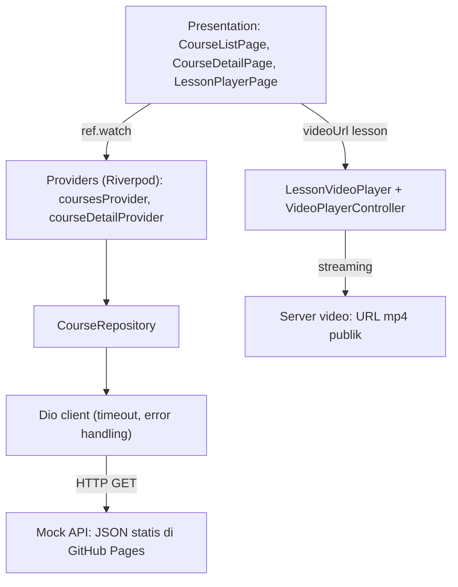
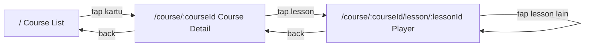
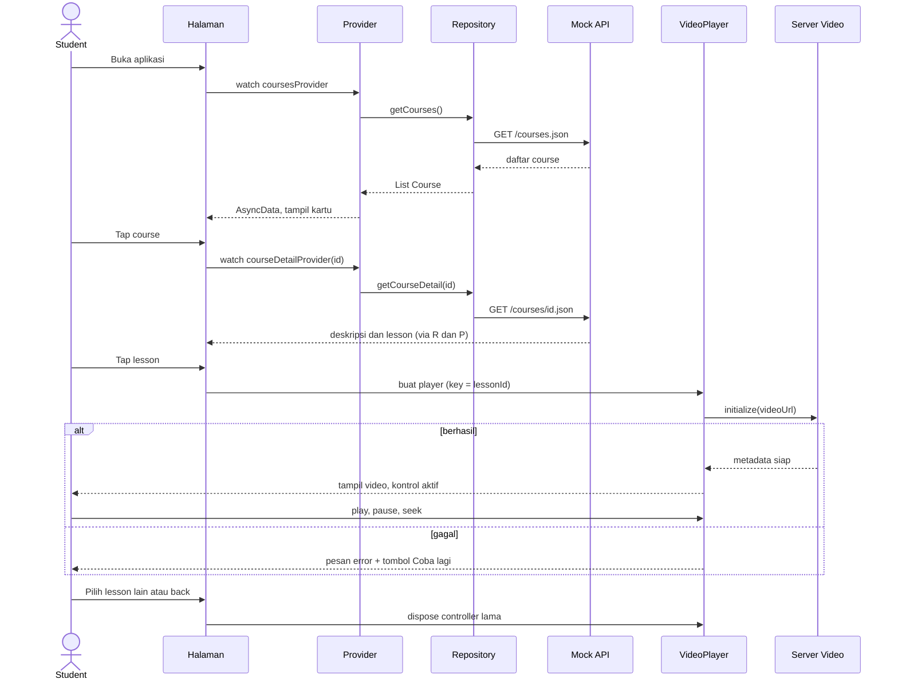
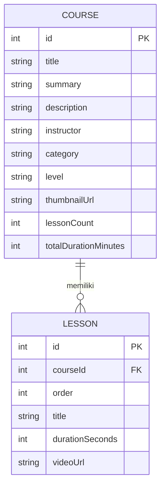
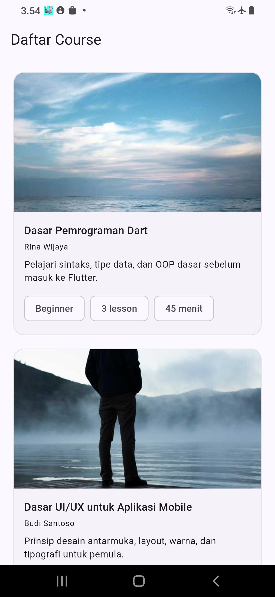
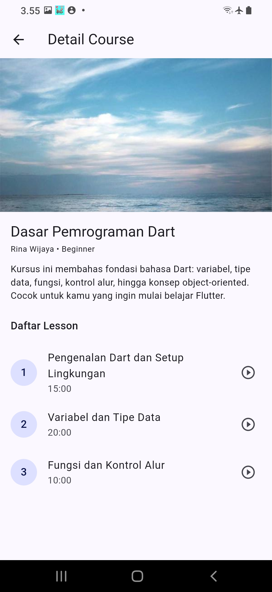
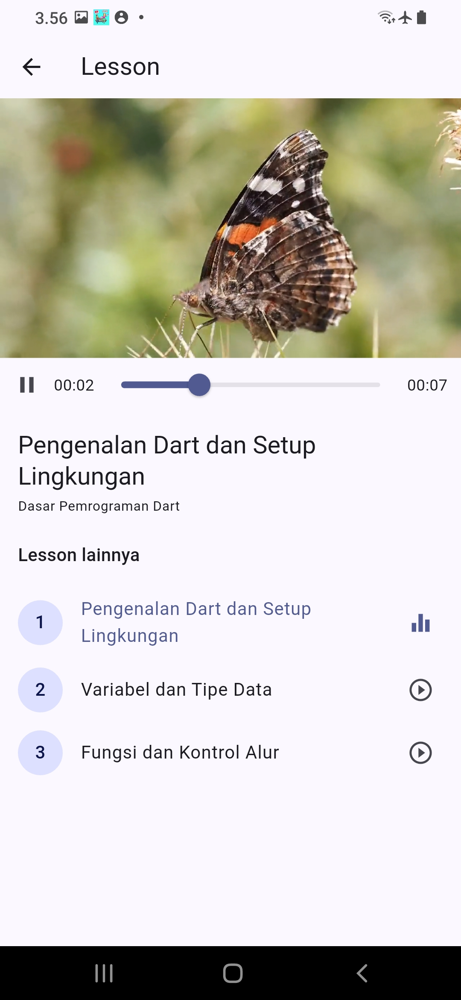
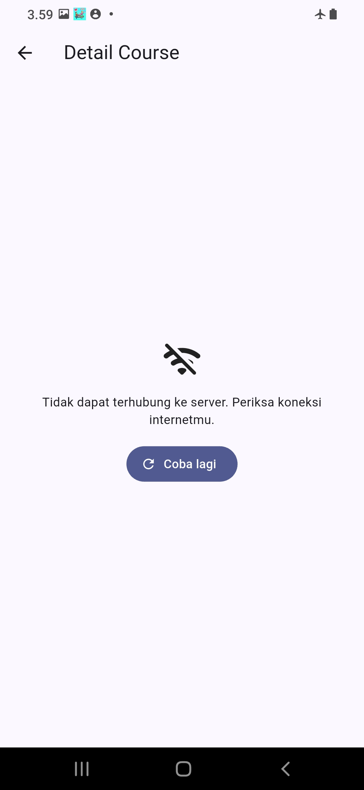

# Dokumen Desain

Dokumen ini memuat system design, model data, kontrak API, alur pemutaran video, dan rancangan UI untuk aplikasi E-Learning (Flutter, Student).

## 1. System Design

Komponen utama dan arah alur data. Panah ke bawah adalah permintaan, hasilnya mengalir kembali ke atas.



Keputusan desain:

- UI tidak mengenal Dio atau URL. Semua lewat `CourseRepository`, sehingga mengganti mock ke API asli hanya menyentuh lapisan data.
- Daftar course ringan (tanpa lesson). Detail dan lesson dimuat saat course dibuka.
- Player berdiri sendiri sebagai widget yang mengelola controllernya sendiri.

## 2. Navigasi



## 3. Alur Buka Course sampai Putar Video



## 4. Model Data



Catatan:

- `lessonCount` dan `totalDurationMinutes` hanya ada di respons list agar kartu course dapat tampil tanpa memuat lesson.
- `description` hanya ada di respons detail.
- `durationSeconds` berupa angka. Format tampilan (mm:ss) diurus aplikasi.
- `order` menentukan urutan lesson. Aplikasi mengurutkan sendiri, tidak bergantung pada urutan array.

Kelas Dart: `Course` (list), `CourseDetail` (detail + `List<Lesson>`), dan `Lesson`, di `lib/features/courses/data/course_models.dart`.

## 5. Kontrak API / Mock

Base URL: `https://zaidanrazzak190804-blip.github.io/elearning-mock-api`

Semua respons dibungkus field `data` (konvensi umum, memudahkan penambahan `meta` atau paginasi nanti).

### `GET /courses.json`

```json
{
  "data": [
    {
      "id": 1,
      "title": "Dasar Pemrograman Dart",
      "summary": "Pelajari sintaks, tipe data, dan OOP dasar sebelum masuk ke Flutter.",
      "instructor": "Rina Wijaya",
      "category": "Programming",
      "level": "Beginner",
      "thumbnailUrl": "https://picsum.photos/seed/dart/600/400",
      "lessonCount": 3,
      "totalDurationMinutes": 45
    }
  ]
}
```

### `GET /courses/{id}.json`

```json
{
  "data": {
    "id": 1,
    "title": "Dasar Pemrograman Dart",
    "description": "Kursus ini membahas fondasi bahasa Dart ...",
    "instructor": "Rina Wijaya",
    "category": "Programming",
    "level": "Beginner",
    "thumbnailUrl": "https://picsum.photos/seed/dart/600/400",
    "lessons": [
      {
        "id": 101,
        "courseId": 1,
        "order": 1,
        "title": "Pengenalan Dart dan Setup Lingkungan",
        "durationSeconds": 900,
        "videoUrl": "https://flutter.github.io/assets-for-api-docs/assets/videos/butterfly.mp4"
      }
    ]
  }
}
```

## 6. Penanganan Kondisi

| Kondisi | Penanganan |
|---|---|
| Loading data | `CircularProgressIndicator` (`AsyncValue.loading`) |
| Data kosong | `EmptyView` dengan pesan |
| Error jaringan | `ErrorView` dengan pesan dari `friendlyError` dan tombol "Coba lagi" |
| Timeout dan koneksi gagal | Timeout 10 detik di Dio, dipetakan ke pesan ramah |
| Video gagal dimuat | Pesan error di area player dengan tombol "Coba lagi" |
| Buffering | Spinner di atas video |
| Video selesai | Ikon tombol berubah menjadi replay |
| Gambar thumbnail gagal | Ikon pengganti |

## 7. UI/UX

Prinsip: sederhana, konsisten, dan mudah digunakan.

- **Warna**: Material 3 dengan seed color indigo (`#3F51B5`).
- **Tipografi**: bawaan Material 3 (`titleLarge`, `titleMedium`, `bodySmall`), tanpa font tambahan.
- **Spacing**: kelipatan 4 dan 8 (padding 16, jarak antar kartu 12).
- **Komponen**: kartu dengan sudut membulat 16 dan outline tipis, chip untuk info singkat, `ListTile` untuk lesson.
- **Responsif**: layout berbasis `ListView` dan `AspectRatio` sehingga menyesuaikan lebar layar.

### Tampilan aplikasi

Screenshot berikut diambil dari aplikasi yang berjalan di perangkat Android.

| Halaman | Isi |
|---|---|
| Course List | AppBar "Daftar Course", kartu: thumbnail 16:9, judul, instruktur, ringkasan 2 baris, chip level, jumlah lesson, durasi |
| Course Detail | Thumbnail, judul, instruktur dan level, deskripsi, daftar lesson (nomor, judul, durasi) |
| Lesson Player | Video 16:9, kontrol play/pause, slider seek, waktu, judul lesson, daftar lesson lain dengan penanda lesson aktif |

**Course List**



**Course Detail**



**Lesson Player**



**Kondisi Error**


